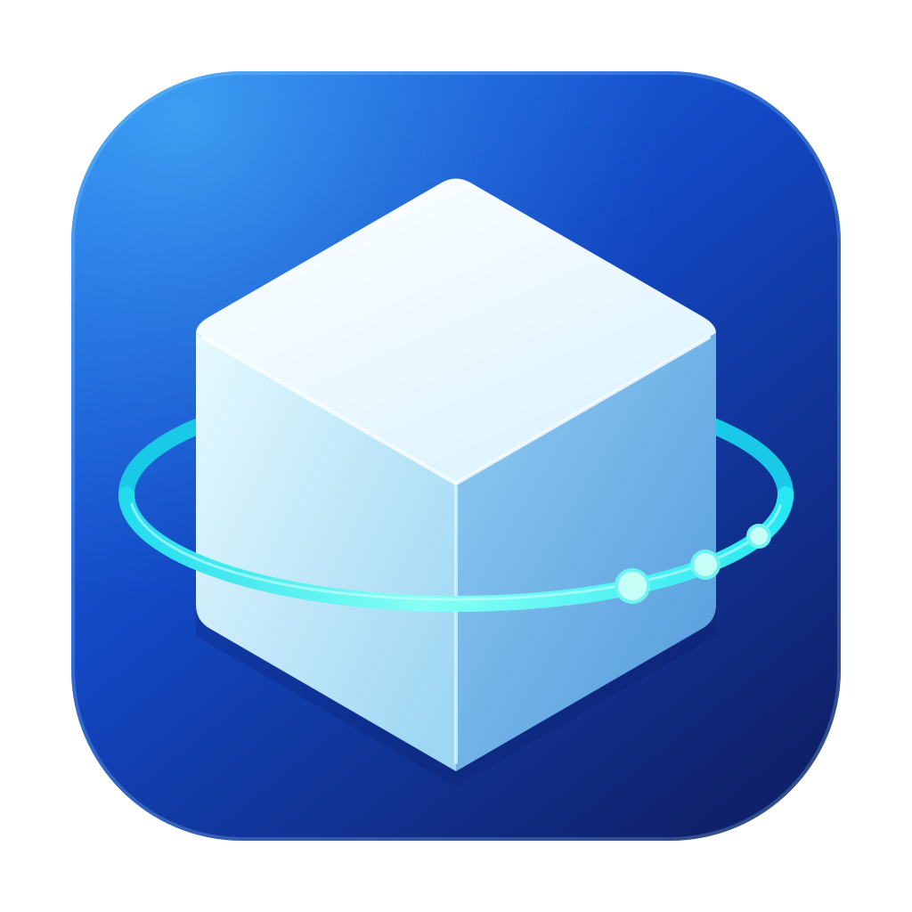
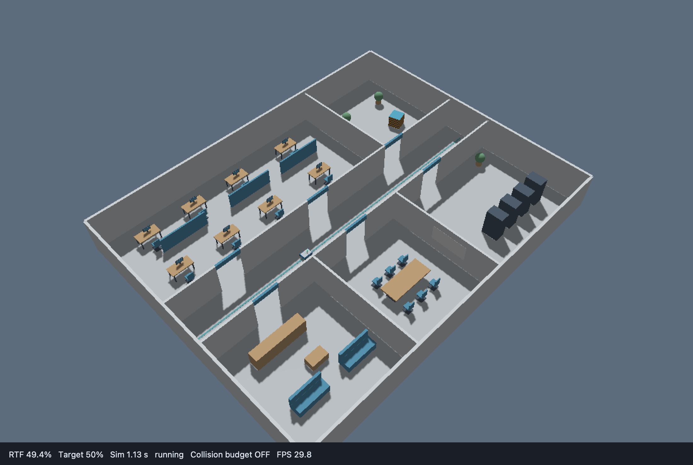
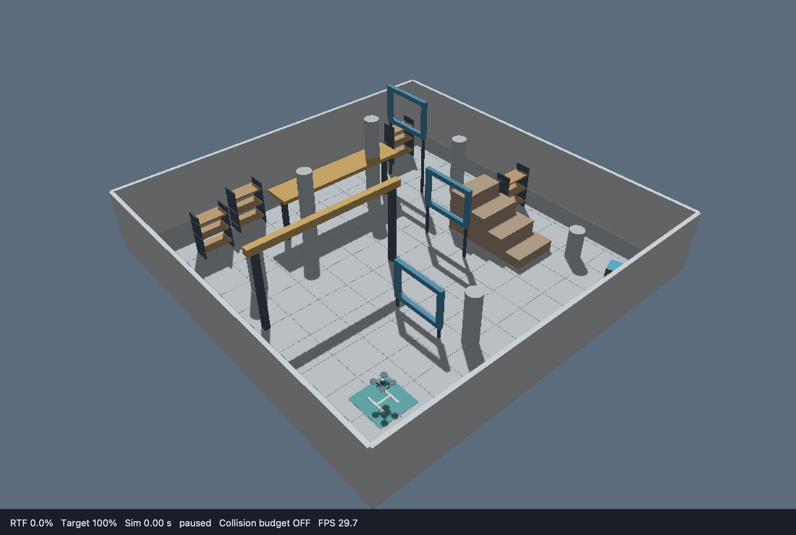

<h1 align="center">LiteSim 3D</h1>

<p align="center">
  
</p>

<p align="center">Lightweight 3D robotics simulation for ROS 2 on Linux</p>

<p align="center">
  <strong>English</strong> · <a href="README.zh-CN.md">简体中文</a>
</p>

<p align="center">
  <a href="#features">Features</a> ·
  <a href="#requirements">Requirements</a> ·
  <a href="#quick-start">Quick start</a> ·
  <a href="#documentation">Documentation</a> ·
  <a href="#development">Contributing</a>
</p>

---

LiteSim 3D is a C++17 kinematic simulator for ROS 2 robot model integration, sensor processing, and algorithm development. Motion, geometric collisions, LiDAR, and IMU run on the CPU; an optional 3D viewer and RGB/depth cameras use Ogre2 rendering.

| Four-wheel robot in an office | Drone in a 3D flight course |
| --- | --- |
|  |  |

## Features

- **Robot models:** two/four-wheel differential, articulated Ackermann, three/four ordinary omni-wheel chassis, and velocity-controlled multicopters.
- **Scenes:** composed URDF/Xacro models, supported SDF assets, fixed obstacles, geometric collisions, and terrain constraints.
- **Sensors:** VLP-16, Mid-360, and Mid-40 scan presets, rolling scans, measurement noise, IMU, encoder odometry, and optional RGB/depth images.
- **ROS 2 integration:** sensor topics, TF, simulation time, pause/step control, and shared-world simulation for one to four identical robots.
- **Extensions:** replace chassis, odometry, and sensor implementations through installed plugins without rebuilding the core.

The simulator uses kinematics and geometric constraints. It does not model contact forces, suspension, tire dynamics, motor thrust, or flight-controller dynamics. See [version and validation status](docs/版本与验证状态.md) for the current development snapshot and tested scope.

<a id="development-environment"></a>
## Requirements

| Component | Requirement |
| --- | --- |
| Operating system and ROS | Ubuntu 22.04 LTS + ROS 2 Humble |
| Build tools | C++17, CMake ≥ 3.20, colcon, Python ≥ 3.10, Bash |
| Optional viewer and cameras | Qt 5, Gazebo Rendering 6 / Ogre2, and a working graphics environment |

First complete [dependency installation](docs/usage/安装与构建.md#安装依赖), including ROS 2 Humble, the build tools, and rosdep setup. Build options and installation paths are documented in [Installation and build](docs/usage/安装与构建.md).

## Quick start

For a complete description-to-simulation workflow, follow the [dual MID-360 tutorial (Chinese)](docs/tutorials/双MID360从零搭建.md): clone, separate description and bringup packages, world configuration, URDF sensors, bringup.launch.py, build, and control. The [standalone example](examples/dual_mid360/README.md) includes all required model and configuration files.

### 1. Clone and build

In a Bash terminal with the prerequisites installed:

```bash
source /opt/ros/humble/setup.bash
git clone --branch humble https://github.com/chiway-luo/litesim3d_ros2.git
cd litesim3d_ros2
rosdep install --from-paths . --ignore-src --rosdistro humble -y
bash scripts/build.sh
source "$(python3 scripts/paths.py install)/setup.bash"
```

Continue only after all packages finish without failures. Run the remaining commands from this cloned repository directory.

### 2. Start the office robot

In the same terminal (A):

```bash
export ROS_DOMAIN_ID=70 ROS_LOCALHOST_ONLY=1
ros2 launch wheel_car_4w_sim wheel_car_4w.launch.py gui:=false rviz:=false cameras:=false lidar_profile:=vlp16 lidar_interface:=native
```

This first run uses the office scene, VLP-16, and native PointCloud2 with no windows or cameras. Keep terminal A running; use one simulation world per ROS domain.

### 3. Verify data and motion

Open terminal B, enter the same repository directory, and run:

```bash
source /opt/ros/humble/setup.bash
source "$(python3 scripts/paths.py install)/setup.bash"
export ROS_DOMAIN_ID=70 ROS_LOCALHOST_ONLY=1
python3 docs/examples/ros_client.py --drive --linear 0.1 --angular 0.0 --duration 8 --require-imu --require-motion
```

Success means the JSON output contains `success: true` and `checks.motion: true`: the client received sensor data, sent velocity commands, and observed at least 1 cm of odometry displacement. It sends zero velocity before exiting. Press Ctrl+C in terminal A to stop the simulation.

To open the 3D viewer, stop the launch and repeat step 2 with `gui:=true`. For individual data checks, manual control, and troubleshooting, follow the [complete first-run tutorial](docs/tutorials/启动与控制.md).

Measurement errors default to zero. To test algorithm robustness, use the per-sensor and wheel odometry [noise configuration](docs/usage/传感器配置.md).

Ackermann and three/four-wheel ordinary omni examples also use external ros2_control; see the [controller and bringup tutorial](docs/tutorials/阿克曼与全向轮ros2_control.md).

## Documentation

Use the [documentation index](docs/README.md) to choose a task. Detailed guides are currently in Chinese; the [Chinese README](README.zh-CN.md) follows the same quick-start path.

| Entry | What it covers |
| --- | --- |
| [Tutorials](docs/tutorials/README.md) | Start and control the robot, add an IMU, and write a ROS 2 consumer |
| [User manual](docs/usage/README.md) | Daily operation, model/sensor configuration, scenes, multiple robots, resets, and troubleshooting |
| [API reference](docs/api/README.md) | Topics, messages/services, QoS, parameters, data layouts, and C++/plugin contracts |
| [Plugin parameters](docs/api/plugins/README.md) | Types, required fields, defaults, units, and constraints for each standard plugin |
| [Robot and extension examples](examples/README.md) | Complete car/drone projects and external plugins |
| [Runtime concepts](docs/concepts/运行与坐标.md) | Configuration flow, TF ownership, simulation time, and reset behavior |
| [Version and validation status](docs/版本与验证状态.md) | Supported scope, recorded checks, and interface compatibility |

## Development

Start with the [repository layout](docs/usage/目录与迁移.md), [plugin development](docs/development/插件开发.md), [testing guide](docs/testing/README.md), and [documentation maintenance](docs/development/文档维护.md). Project history is recorded in the [changelog](CHANGELOG.rst); the version source is [VERSION](VERSION).

When reporting an issue, include the Ubuntu/ROS versions, repository revision, launch command, reproduction steps, and relevant logs. For contributions, describe the behavior change and the checks actually performed. Maintainer contact: [chiwayfpv@gmail.com](mailto:chiwayfpv@gmail.com).

## License

[Apache-2.0](LICENSE). Bundled third-party materials retain their own license notices.

All existing vehicle examples now default to external ros2_control, including the four-wheel car and kinematic multicopter. See the [unified integration and third-party controller tutorial](docs/tutorials/全部模型与第三方算法ros2_control.md).
