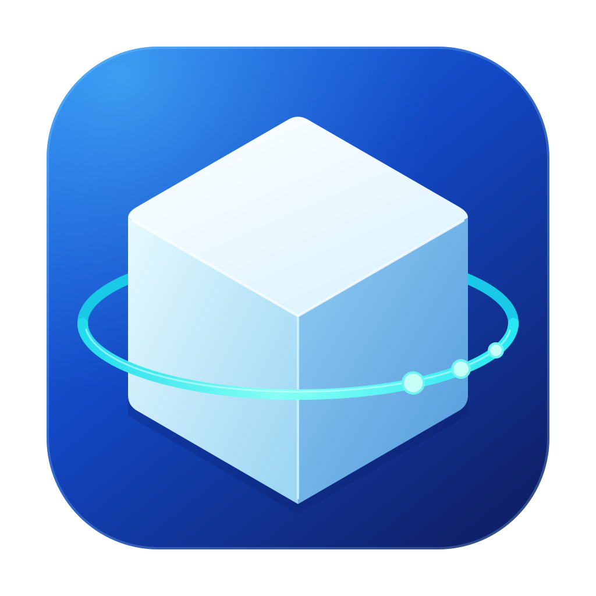
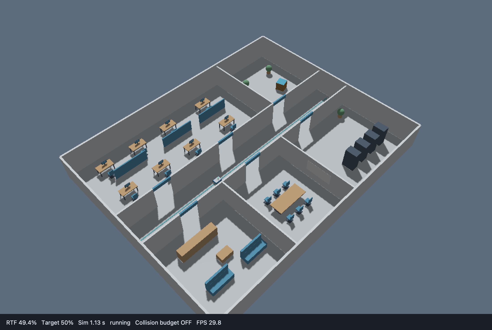
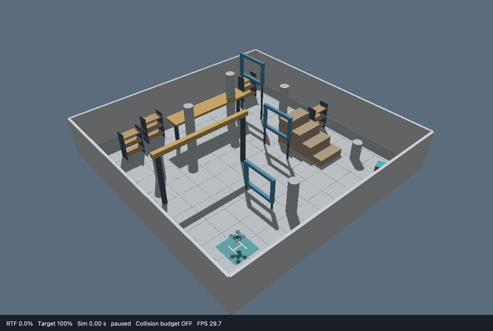

<h1 align="center">LiteSim 3D</h1>

<p align="center">
  
</p>

<p align="center">面向 Linux 与 ROS 2 的轻量机器人三维仿真器</p>

<p align="center">
  <a href="README.md">English</a> · <strong>简体中文</strong>
</p>

<p align="center">
  <a href="#主要功能">主要功能</a> ·
  <a href="#开发环境">开发环境</a> ·
  <a href="#快速开始">快速开始</a> ·
  <a href="#文档">文档</a> ·
  <a href="#开发与贡献">开发与贡献</a>
</p>

---

LiteSim 3D 是基于 C++17 的三维运动学仿真器，用于 ROS 2 机器人算法的开发与测试。运动、几何碰撞、雷达和 IMU 数据在 CPU 上计算，通过 ROS 2 发布传感器数据、里程计、TF 和仿真时钟；可选三维查看器及 RGB/深度相机使用 Ogre2 渲染。

文档提供的开发与运行环境为 **Ubuntu 22.04 + ROS 2 Humble**。

| 办公区四轮小车 | 三维飞行场地无人机 |
| --- | --- |
|  |  |

## 主要功能

- **机器人模型**：双轮/四轮差速、具有转向关节的阿克曼、三轮/四轮普通全向插件，以及兼容的速度控制无人机；支持 URDF/Xacro 和限定范围的 SDF。
- **场景与碰撞**：固定障碍物的三维几何碰撞、连续坡面，以及带材质和贴图的 SDF 场景；轮式机器人可配置碰撞后轮子与轮式里程计继续累计。
- **传感器**：VLP-16、Mid-360、Mid-40 扫描预设，滚动扫描、测量噪声、IMU、里程计和可选 RGB/深度相机。
- **ROS 2 接口**：点云、图像、TF、仿真时钟、暂停/单步控制和单机会话重置。
- **运行示例**：四轮小车办公区、阿克曼、三轮/四轮全向、无人机飞行场地，以及 1–4 台同构机器人的共享世界仿真。

仿真采用运动学和几何约束，不模拟接触力、悬架、轮胎动力学、电机推力或飞控动力学。传感器预设属于仿真模型，具体建模范围见 [雷达配置说明](examples/wheel_car_4w/雷达配置说明.md)。

底盘、编码器里程计与五类传感器分别由独立插件包提供；可安装外部包并修改模型声明替换，无需重编核心。见 [模型组合与插件迁移](docs/usage/模型组合与插件迁移.md) 和 [插件开发](docs/development/插件开发.md)。

## 开发环境

| 组件 | 要求 |
| --- | --- |
| 操作系统 | Linux：Ubuntu 22.04 LTS |
| ROS | ROS 2 Humble |
| 编译与构建工具 | C++17、CMake ≥ 3.20、colcon |
| Python 与 Shell | Python ≥ 3.10、Bash |
| 三维窗口与相机 | Qt 5、Gazebo Rendering 6 / Ogre2，以及可用的图形环境 |

先按 [ROS 2 官方 Ubuntu 安装说明](https://docs.ros.org/en/humble/Installation/Ubuntu-Install-Debs.html) 安装 Humble，再安装构建工具并初始化 rosdep。获取源码后，由 rosdep 根据每包清单安装项目依赖：

```bash
source /opt/ros/humble/setup.bash
sudo apt update
sudo apt install -y git build-essential cmake pkg-config ninja-build \
  python3-colcon-common-extensions python3-rosdep
if [ ! -f /etc/ros/rosdep/sources.list.d/20-default.list ]; then
  sudo rosdep init
fi
rosdep update --rosdistro humble
```

依赖说明、标准 colcon 工作空间及不构建图形包的方式见 [安装与构建](docs/usage/安装与构建.md)。其他 Linux 发行版和 ROS 版本尚未验证。[CI 工作流](.github/workflows/m1.yml) 使用 Ubuntu 22.04 与 Humble，实际结果及验证范围见 [测试文档](docs/testing/README.md)。

## 快速开始

### 1. 获取源码并构建

安装依赖后，在 Bash 终端执行：

```bash
source /opt/ros/humble/setup.bash
git clone https://github.com/chiway-luo/litesim3d_ros2.git -b humble
cd litesim3d_ros2
rosdep install --from-paths . --ignore-src --rosdistro humble -y
bash scripts/build.sh
source "$(python3 scripts/paths.py install)/setup.bash"
```

默认完整构建成功应显示 **29 packages finished**。构建产物保存在源码仓库外，`scripts/paths.py install` 用于定位生成的安装环境。

### 2. 启动仿真

在同一终端启动办公区中的四轮小车：

```bash
export ROS_DOMAIN_ID=70 ROS_LOCALHOST_ONLY=1
ros2 launch wheel_car_4w_sim wheel_car_4w.launch.py
```

鼠标左键拖动旋转视角，中键或右键拖动平移，滚轮缩放。底部状态栏显示实际 RTF、目标 RTF、FPS 和碰撞预算状态。

仅使用终端时，改用以下启动命令：

```bash
ros2 launch wheel_car_4w_sim wheel_car_4w.launch.py gui:=false cameras:=false
```

### 3. 控制机器人

新开一个 Bash 终端，进入刚才克隆的 `litesim3d_ros2` 目录，加载环境并发送速度指令：

```bash
source /opt/ros/humble/setup.bash
source "$(python3 scripts/paths.py install)/setup.bash"
export ROS_DOMAIN_ID=70 ROS_LOCALHOST_ONLY=1
ros2 topic pub --rate 10 /cmd_vel geometry_msgs/msg/Twist \
  '{linear: {x: 0.3}, angular: {z: 0.2}}'
```

按 Ctrl+C 停止发送后，小车在 0.5 秒仿真时间的命令超时后减速停车；在 launch 终端按 Ctrl+C 退出仿真。所有终端使用相同的 `ROS_DOMAIN_ID`，每个 domain 同时运行一个仿真世界；`ROS_LOCALHOST_ONLY=1` 将 ROS 通信限定在本机。

查看点云消息头：

```bash
ros2 topic echo /points_raw --once --field header --qos-reliability best_effort
```

## 示例与配置

在同一 ROS domain 中切换示例前，先停止正在运行的仿真。

| 示例 | 启动命令 |
| --- | --- |
| 办公区四轮小车 | `ros2 launch wheel_car_4w_sim wheel_car_4w.launch.py` |
| 四轮小车搭配 Mid-360 | `ros2 launch wheel_car_4w_sim wheel_car_4w.launch.py lidar_profile:=mid360` |
| 小型仓库场景 | `ros2 launch wheel_car_4w_sim wheel_car_4w.launch.py world:=warehouse.sdf` |
| 无人机三维飞行场地 | `ros2 launch drone_3d_sim drone_3d.launch.py` |

无人机初始悬停在起降区上方 1.2 米；`linear.x/y/z` 控制机体三轴平移，`angular.z` 控制偏航，机体保持水平。控制指令、话题和模型参数见 [四轮小车示例](examples/wheel_car_4w/README.md) 与 [无人机示例](examples/drone_3d/README.md)。

相机默认关闭。有可用 Ogre2 图形后端时，在启动命令后增加 `cameras:=true`，可开启 **640 × 480、15 Hz** 的 RGB 输出；深度数据需在 runtime 配置中设置 `type: rgbd` 或 `type: depth`。相机默认只发布 ROS 话题，不打开独立预览窗口；即使 `gui:=false`，相机仍需要渲染后端。详见 [相机配置](docs/usage/SDF与独立窗口.md#车载-rgb-与深度相机)。

小车资源由 [`wheel_car_4w_models`](examples/wheel_car_4w/wheel_car_4w_models/README.md) 安装，无人机资源由 [`drone_3d_models`](examples/drone_3d/drone_3d_models/README.md) 安装；两个包分别保存各自的模型、场景和贴图。碰撞检测默认启用；增加 `collision_budget_enabled:=true` 可启用额外的复杂度检查。SDF 支持范围、材质和自定义场景用法见 [SDF 与独立窗口](docs/usage/SDF与独立窗口.md)。

## 文档

| 入口 | 内容 |
| --- | --- |
| [安装与构建](docs/usage/安装与构建.md) | Linux 依赖、构建选项与安装路径 |
| [使用文档](docs/usage/README.md) | 环境安装、运行案例、参数、模型接入、算法接入、多机器人与重置 |
| [测试文档](docs/testing/README.md) | 回归命令、验收规范、历史结果、证据位置与未验证项 |
| [开发设计](docs/design/开发方案.md) | 模块职责、需求与阶段规划；历史规划以当前使用手册为准 |

## 源码结构

```text
litesim3d_ros2/
├── VERSION                 # 项目版本（主版本.次版本.修订版本）
├── litesim3d_core/          # C++ 内核、资源与测试；使用 pluginlib，不启动 DDS 节点
├── litesim3d_bringup/       # 公共启动流程，不依赖任何示例包
├── litesim3d_test_support/  # 包级 DDS 测试共享辅助模块
├── litesim3d_assets/        # SDF 导入、资源校验与内部适配
├── litesim3d_gui/           # Qt/Ogre2 三维窗口、RGB/深度传感器与可选图像预览
├── litesim3d_interfaces/    # ROS 消息和服务定义
├── litesim3d_ros2/          # ROS 节点、launch、RViz、会话管理与集成测试
├── examples/wheel_car_4w/  # wheel_car_4w_models、description、sim 三个示例包
├── examples/drone_3d/      # drone_3d_models 和 drone_3d_sim 两个示例包
├── standalone/             # 不启用 ROS 桥接的 CMake 入口
├── scripts/                # 构建、测试、检查与报告工具
├── docs/{usage,testing,design}/
└── .github/workflows/      # Ubuntu Humble CI
```

构建产物和原始测试日志保存在仓库外。包职责与产物位置见 [目录说明](docs/usage/目录与迁移.md)。

## 开发与贡献

仓库版本由根目录 [VERSION](VERSION) 统一声明，各 ROS 包清单必须与它一致。每个包从自己的 `package.xml` 构建，核心将该包版本写入运行清单，因此独立发布的包无需仓库根目录。升级时同步修改各包的 `package.xml`，再执行下面的版本检查；`scripts/build.sh` 也会在构建前自动检查。

完成构建并加载 ROS 环境后，在仓库根目录执行：

```bash
python3 scripts/checks/check_versions.py
python3 scripts/checks/check_repository_docs.py
bash scripts/test_m3.sh
```

默认功能回归不包含桌面渲染、正式性能测量和长时间稳定性测试；对应检查及其环境要求见 [测试文档](docs/testing/README.md)。

反馈问题时，请提供 Ubuntu 与 ROS 版本、仓库版本、启动命令、复现步骤和相关日志。提交代码变更时，请说明行为变化及实际执行的验证。

[开发日志](CHANGELOG.rst) 记录项目历史，并链接到每个包的 `CHANGELOG.rst`。面向首次 0.4.0 发布的变更暂列在 `Forthcoming`，正式准备发布时再确定版本日期。

LiteSim 3D 使用 [Apache-2.0 许可证](LICENSE)，随附第三方材料保留各自的许可声明。维护者邮箱：[chiwayfpv@gmail.com](mailto:chiwayfpv@gmail.com)。
