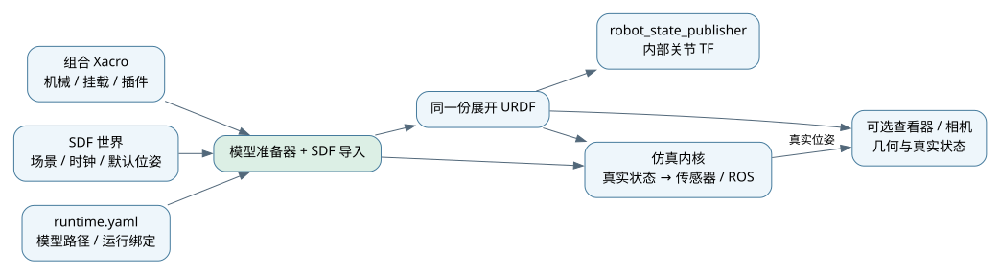
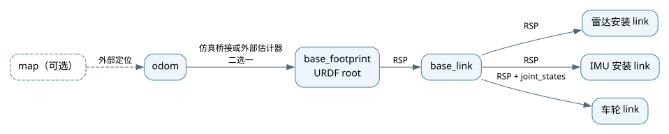
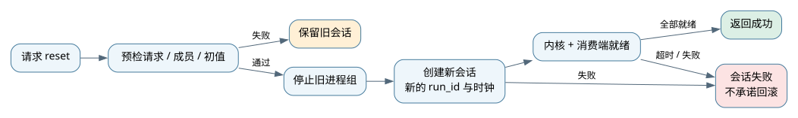

# 运行、配置与坐标

本页解释四轮组合模型的配置来源、数据流、TF 和生命周期。操作从[入门教程](../tutorials/README.md)开始；字段定义见[接口参考](../api/README.md)。

## 配置怎样进入运行时

Xacro 提供机械模型、安装坐标和插件声明；SDF 提供世界几何、时钟和机器人 root 出生位姿；runtime 连接机器人与世界并设置运行选项。准备器展开一次组合模型，仿真与 RSP 使用同一份 XML，查看器的机器人几何也由这份模型生成。

插件参数按“实现默认值 → 声明顺序的参数文件 → 实例 overrides”覆盖。映射递归合并，数组整体替换；修改后重新启动。不能在组合模型与旧 YAML 中重复定义同一类插件。完整规则见[插件接口](../api/插件接口.md#扩展标签和参数优先级)。

## TF 的发布责任

四轮车的 URDF root 为 `base_footprint`。默认由仿真桥接发布 `odom → base_footprint`，RSP 发布机器人内部关节变换。`map → odom` 只有接入相应定位算法后才可能存在，本项目不会自动补出定位结果。

外部估计器接管 odom TF 时，明确关闭仿真对应发布者。每条 TF 边只有一个发布者；话题 namespace 与 frame 前缀需要一起配置。多机的每个机器人使用独立局部 odom，不能仅把 RViz Fixed Frame 改为 `world` 就获得全局定位。

传感器使用真实车体/关节状态生成测量，不从有误差的 odom TF 反推真值。碰撞时编码器可继续累计，odom 与真实位置可能分离；安装外参仍由同一模型确定。坐标与单位见[坐标约定](../api/坐标与模型约定.md)。

## 暂停、单步与重新开始

暂停停止仿真时间和传感器采样推进；单步从暂停态推进指定步数，传感器按各自采样周期输出，单步不等于每种传感器都发布一帧。运行监测的超时应明确区分墙钟和仿真时间。

SDF 四轮车入口重新开始实验时，停止完整 launch 后重启。基础单机会话入口另提供协调 reset，其过程如下：

预检失败时旧会话保留；旧进程停止后重建失败，不能假定已经回滚。新内核 ready 不等于所有算法消费端都准备好。重置会清空时间和历史，消费端应按新 run_id 管理状态。SDF 入口、多机与基础会话的支持范围不同，详见[会话操作](../usage/会话与重置.md)和[服务契约](../api/消息与服务.md)。
