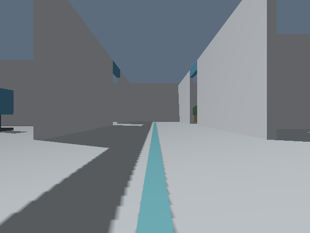
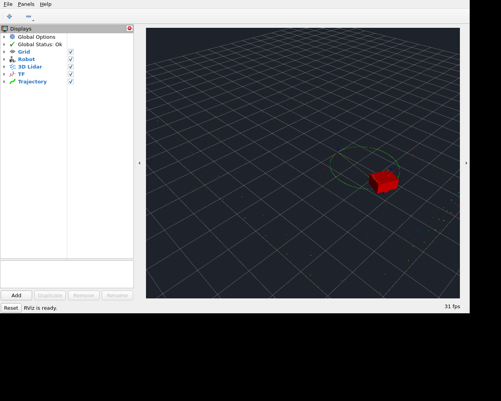

# 测量误差、相机渲染与 RViz 验证

日期：2026-10-20。对象：0.4.0 开发工作树，基线提交 `25d40f8`，包含本次文档整理、测量误差配置、Livox 接口和 RViz 显示调整。环境为 Ubuntu 22.04 ARM64 / ROS 2 Humble，使用已有 Lima 虚拟机中的 Xvfb、Mesa 软件 OpenGL 和 Ogre 渲染后端。

## 功能边界

- `rviz`、`rviz_config` 启动参数及依赖保留。仅从三个内置 RViz 模板移除 `/scene` 的 `MarkerArray` 环境图层；机器人、点云和其他观察图层保留。独立三维窗口继续显示环境。
- 标准轮式里程计的相对比例误差、固定偏移和随机噪声默认均为 0；旧倍率参数仍以 1 表示理想值。轮式误差只扰动估计量，不改变真实运动。
- 雷达、IMU、RGB、Depth、RGB-D 的误差默认均为 0。`noise_config` 按模型实例名覆盖误差参数，拒绝未知实例和非误差字段。
- Mid-360 输出使用官方原样消息定义的纯接口包；其余雷达和 IMU 接口保留。该包不含硬件驱动或设备通信。

## 已执行检查

| 检查 | 结果 |
| --- | --- |
| 包构建 | 30 个包通过，包含本次源码的 GUI 渲染组件 |
| 常规回归 `scripts/test_m3.sh` | 375 项通过；18 项图形用例在无显示环境中跳过，随后全部在桌面套件中通过 |
| 其中：核心 C++ | 174 项通过 |
| 其中：ROS 接口 | 97 项通过、1 项图形用例跳过；包含 100 次完整会话重置及首帧检查 |
| 其中：Livox 专项 | 8 项通过，已计入 ROS 接口结果 |
| 插件运动学、里程计及传感器契约 | 39 项通过 |
| 桌面集成 | 20 项通过，无跳过；含相机、RViz、独立窗口和无人机图形用例 |
| 渲染几何基准 | 通过；RGB/深度配准、光轴朝向、内参、轴向深度和超量程 NaN 均校验 |
| RViz 独立性 | 开、关各运行 60 秒仿真；每组 600 帧点云、3000 条 odom，一致性通过 |

常规回归的 393 项用例由核心 174、ROS 98、报告检查器 37、小车 40、SDF 29、无人机 4、集成 7 及 launch 4 项组成。图形跳过项分别为 ROS 1、小车 15、无人机 2 项。桌面结果来自 `scripts/test_desktop.sh`，覆盖这 18 项，并重复验证 2 项无人机基础用例，不能直接相加为独立用例总数。渲染几何基准作为独立命令记录，不重复计入 20 项 pytest 用例。

RViz 对照比较完整消息字段、点数据字节、最终位姿和命令应用记录；CDR 比较仅忽略协议对齐填充字节。Livox 专项覆盖原样消息定义、原生点云几何一致性、命名空间、共享世界、与其他雷达共存、IMU 保持性及非法参数拒绝。

首轮补测发现模板删除后的 YAML 缩进错误和测试对 NumPy 数组的布尔比较错误，修复后完整桌面套件通过；失败日志与重跑结果同时保留。

## 相机渲染与误差

测试读取实际 Ogre 渲染结果，经插件后处理和 DDS 发布后再检查，覆盖 RGB、Depth、RGB-D 三种类型。

| 条件 | 检查及结果 |
| --- | --- |
| 零误差 | 静止场景的相邻帧像素相同；图像非空，深度有有效几何分布 |
| 固定偏移 | RGB 分别增加 `[7,-5,11]` DN，逐像素核对取整/裁剪；深度增加 0.05 m，逐像素核对 |
| 随机噪声 | RGB 标准差配置 `[2,3,4]` DN，实测约 `[2.021,3.001,3.999]` DN；深度配置 0.01 m，实测约 0.010017 m |
| 种子复现 | 固定种子、实例名、场景和时间序列，重新启动后的三帧图像字节一致；不同时间戳的噪声帧不同 |
| 消息和时间 | 分辨率、编码、CameraInfo、frame、精确仿真时间戳、不同采样率、多相机与暂停行为通过 |
| 真值隔离 | 发生碰撞后，轮式里程计可继续累积误差，相机仍按实际机器人位姿渲染；插件 RGB/深度偏移验证通过 |
| 生命周期 | 关闭预览后继续采样；渲染进程故障导致 launch 失败；禁用相机不启动渲染器 |

RGB 噪声统计排除裁剪像素，深度噪声统计使用远离量程边界的有效像素。上述数值来自三帧 160×120 图像；不等同于实体相机标定或硬件误差模型验收。

640×480 RGB-D 用例中的真实 RGB 渲染帧：



RViz 对照用例的实际截图，显示列表保留 Robot、3D Lidar、TF、Trajectory，已无 Scene：



## 复现

在 Ubuntu/Humble 环境中，从仓库根目录运行：

```bash
source /opt/ros/humble/setup.bash
bash scripts/build.sh
source "$(python3 scripts/paths.py install)/setup.bash"
bash scripts/test_m3.sh
xvfb-run -a env LIBGL_ALWAYS_SOFTWARE=1 QT_X11_NO_MITSHM=1 \
  bash scripts/test_desktop.sh
xvfb-run -a env LIBGL_ALWAYS_SOFTWARE=1 QT_X11_NO_MITSHM=1 \
  LWS_PRIVATE_TEST_DISPLAY=1 python3 scripts/checks/check_gui_independence.py
```

本机已有 Xvfb/Mesa 及已声明的 ROS/Qt 测试依赖，运行中未安装或升级全局依赖。桌面脚本要求启用 `BUILD_TESTING` 构建产生的 `camera_sensor_test`。测试应使用空闲的 ROS domain；并发检查需隔离 domain 和输出目录。

本轮原始证据保存在仓库外 `artifacts/evidence/rviz-camera-20261020/`，包括源码归档及 SHA-256、JUnit、运行日志、相机统计和原始截图。远端运行由 [ROS CI](../../.github/workflows/m1.yml) 与 [文档 CI](../../.github/workflows/docs.yml) 分别记录；本地结果不代替对应提交的远端状态。

这些结果覆盖软件渲染与接口行为，不覆盖物理 GPU/驱动组合、外部 SLAM/Nav2 算法精度、长时间稳定性或真实设备验收。
