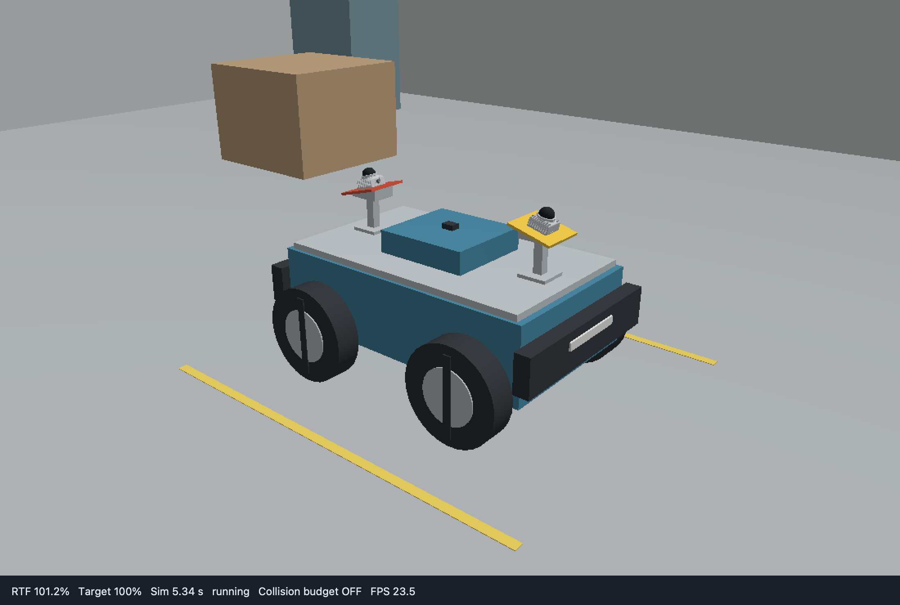
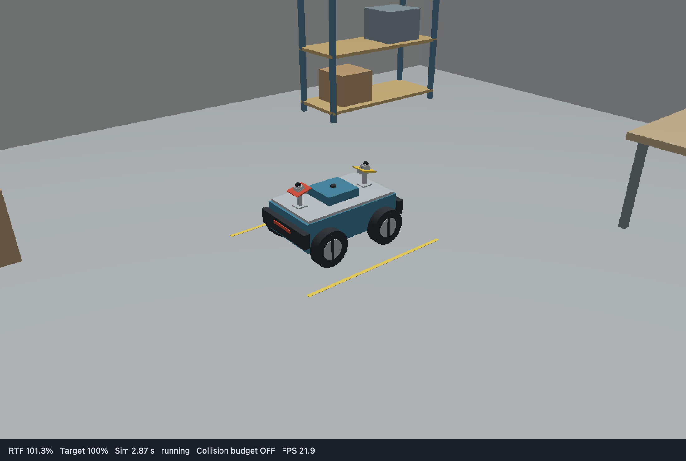
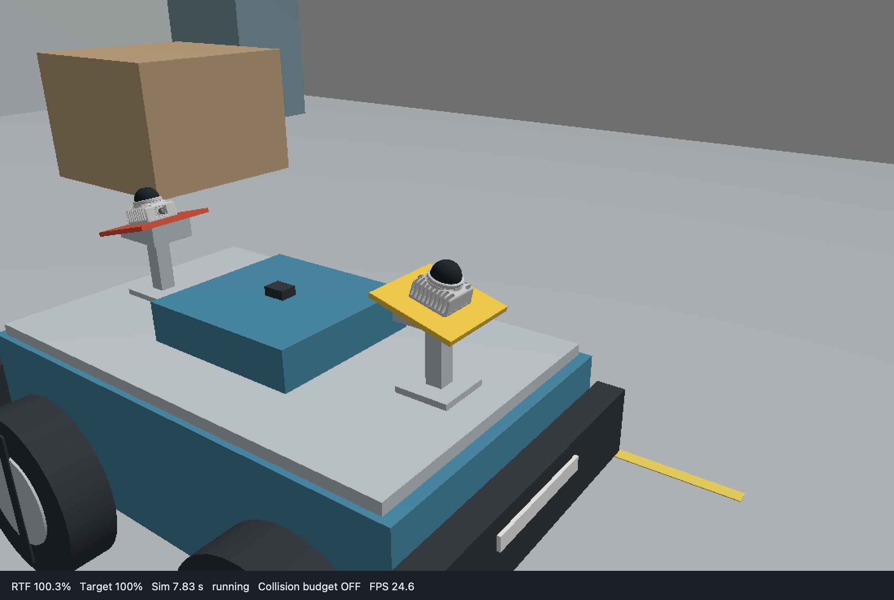

# 双 MID-360：从克隆仓库到配置完整仿真

用独立的 `dual_mid360_description` 和 `dual_mid360_bringup` 包搭建四轮差速小车。先运行[完整示例](../../examples/dual_mid360/README.md)，再修改场景、传感器和控制器；两个包已随仓库提供，无需创建同名包。



## 1. 构建并启动示例

先按[安装依赖](../usage/安装与构建.md#安装依赖)准备 Ubuntu 22.04、ROS 2 Humble 和构建工具。在 Bash 终端执行；已有源码时直接进入仓库目录：

```bash
source /opt/ros/humble/setup.bash
git clone --branch humble https://github.com/chiway-luo/litesim3d_ros2.git
cd litesim3d_ros2
rosdep install --from-paths . --ignore-src --rosdistro humble -y
bash scripts/build.sh
source "$(python3 scripts/paths.py install)/setup.bash"
```

终端 A 启动无窗口仿真：

<!-- tutorial-command: dual-launch -->
```bash
ros2 launch dual_mid360_bringup bringup.launch.py gui:=false rviz:=false
```

终端 B 进入同一源码目录，加载环境并检查两台雷达：

```bash
source /opt/ros/humble/setup.bash
source "$(python3 scripts/paths.py install)/setup.bash"
ros2 topic echo /livox/front_mid360/lidar --once --field header --qos-reliability best_effort
ros2 topic echo /livox/rear_mid360/lidar --once --field header --qos-reliability best_effort
ros2 control list_controllers
```

两路消息的 frame 应分别为 `front_mid360_link`、`rear_mid360_link`；`joint_state_broadcaster` 和 `diff_drive_controller` 应为 active。随后发送速度：

```bash
ros2 topic pub -r 10 /cmd_vel geometry_msgs/msg/Twist '{linear: {x: 0.15}, angular: {z: 0.0}}'
```

按 Ctrl+C 停止发布，再发送零速度并读取里程计：

```bash
ros2 topic pub --once /cmd_vel geometry_msgs/msg/Twist '{linear: {x: 0.0}, angular: {z: 0.0}}'
ros2 topic echo /odom --once
```

位姿应随行驶发生变化。终端 A 按 Ctrl+C 结束整套仿真。需要查看工作间和 RViz 时，重新运行 `ros2 launch dual_mid360_bringup bringup.launch.py`。

## 2. 找到要修改的文件

下面的路径均相对 `examples/dual_mid360/`。

| 文件 | 用途 |
| --- | --- |
| [description/urdf/rover.urdf.xacro](../../examples/dual_mid360/dual_mid360_description/urdf/rover.urdf.xacro) | 车体、轮子、雷达支架和安装 TF |
| [description/config/drive.yaml](../../examples/dual_mid360/dual_mid360_description/config/drive.yaml) | 左右驱动轮关节绑定；尺寸由 URDF 读取 |
| [bringup/worlds/minimal.sdf](../../examples/dual_mid360/dual_mid360_bringup/worlds/minimal.sdf) / [workshop.sdf](../../examples/dual_mid360/dual_mid360_bringup/worlds/workshop.sdf) | 最小场景 / 默认完整工作间 |
| [bringup/urdf/simulation.urdf.xacro](../../examples/dual_mid360/dual_mid360_bringup/urdf/simulation.urdf.xacro) | 引用机械模型，声明底盘、里程计、雷达和 IMU |
| [bringup/config/sensors.yaml](../../examples/dual_mid360/dual_mid360_bringup/config/sensors.yaml) | 两台雷达的采样参数 |
| [bringup/config/runtime.yaml](../../examples/dual_mid360/dual_mid360_bringup/config/runtime.yaml) | 机器人、地形、支撑轮和世界绑定 |
| [bringup/config/ros.yaml](../../examples/dual_mid360/dual_mid360_bringup/config/ros.yaml) / [rsp.yaml](../../examples/dual_mid360/dual_mid360_bringup/config/rsp.yaml) | 出生位姿、仿真节点参数 / RSP 参数 |
| [bringup/urdf/control.urdf.xacro](../../examples/dual_mid360/dual_mid360_bringup/urdf/control.urdf.xacro) | 控制管理器使用的机械模型与硬件接口 |
| [bringup/config/controllers.yaml](../../examples/dual_mid360/dual_mid360_bringup/config/controllers.yaml) | 控制器类型、轮组、限速与超时 |
| [bringup/launch/bringup.launch.py](../../examples/dual_mid360/dual_mid360_bringup/launch/bringup.launch.py) | RSP、控制管理器、仿真和窗口的启动入口 |

修改源码后，在仓库根目录重新执行 `bash scripts/build.sh`，加载安装环境，再启动新会话。

## 3. 配置场景和出生位姿

先用现成最小场景；每次切换场景前停止旧 launch：

<!-- tutorial-command: dual-minimal-launch -->
```bash
ros2 launch dual_mid360_bringup bringup.launch.py world:=minimal.sdf
```

自建场景时复制模板：

```bash
cp examples/dual_mid360/dual_mid360_bringup/worlds/minimal.sdf \
   examples/dual_mid360/dual_mid360_bringup/worlds/my_workshop.sdf
```

编辑 `my_workshop.sdf`，构建后用 `world:=my_workshop.sdf` 启动。

| 要改什么 | 修改位置与单位 |
| --- | --- |
| 地面或障碍物尺寸 | model 内 visual/collision 的 `<size>`，两处一起修改，单位 m |
| 物体位置和朝向 | model 的 `<pose>`，顺序为 `x y z roll pitch yaw`，单位 m/rad |
| 机器人出生位置和朝向 | `config/ros.yaml` 的 `initial_pose_override`，由 launch 加载 |
| 窗口初始视角 | `<gui><camera><pose>` |
| 步长和目标实时率 | `<physics>` 的 `max_step_size`、`real_time_factor` |

默认地板厚 0.1 m、中心 z=-0.05，上表面为 0；未旋转箱体的中心 z 应为支撑面高度加箱高的一半。障碍物固定在配置位置，不会自动落地。

出生位姿在 [ros.yaml](../../examples/dual_mid360/dual_mid360_bringup/config/ros.yaml) 的 `/litesim3d/ros__parameters` 下配置：

```yaml
initial_pose_override: [0.0, 0.0, 0.0, 0.0, 0.0, 0.0, 1.0]
```

顺序为 `[x, y, z, qx, qy, qz, qw]`：前三项是世界坐标中的位置，单位 m；后四项是朝向四元数，`[0, 0, 0, 1]` 表示无旋转。参数表示 `runtime.robot.base_link` 的绝对位姿，覆盖 SDF 中的默认位姿。本例 base_link 在地面，轮心已在 URDF 中设为 z=0.15 m，因此出生 z=0，无需再加轮半径。

默认启动会自动加载包内 `config/ros.yaml`。需要自定义位置时，先复制完整参数文件：

```bash
cp examples/dual_mid360/dual_mid360_bringup/config/ros.yaml /tmp/dual_mid360_ros.yaml
```

修改副本中的 `initial_pose_override`，保留其他参数，停止旧 launch 后加载该文件：

```bash
ros2 launch dual_mid360_bringup bringup.launch.py params:=/tmp/dual_mid360_ros.yaml
```

另一终端可用 `ros2 param get /litesim3d initial_pose_override` 核对加载值。参数在启动时生效；改变出生位姿不需要修改 SDF。SDF 中仍保留与 `runtime.robot.id` 同名、非 static 的机器人占位 model；未设置该 ROS 参数时，才使用 SDF 默认位姿。



## 4. 配置机械模型和双雷达

### 安装坐标与轮组

在 `rover.urdf.xacro` 修改车体尺寸、轮子 collision 和固定关节 `origin xyz/rpy`。安装外参由完整 URDF 关节链提供，仿真和 RSP 共用；YAML 不重复填写安装坐标。

`drive.yaml` 只绑定独立驱动关节：

```yaml
left_joints: [front_left_wheel_joint, rear_left_wheel_joint]
right_joints: [front_right_wheel_joint, rear_right_wheel_joint]
```

底盘、编码器里程计和控制器从完整 URDF 自动读取轮径与轮距。车轮 collision 须为可确定半径的共轴圆柱。

| 安装项 | 前雷达 | 后雷达 |
| --- | --- | --- |
| link | `front_mid360_link` | `rear_mid360_link` |
| 默认扫描原点，相对 base_link，m | `(0.334235, 0, 0.576523)` | `(-0.334235, 0, 0.576523)` |
| 默认 RPY | `(0°, 15°, 0°)` | `(0°, 15°, 180°)` |

两台雷达各向外俯倾 15°。扫描原点与底座中心不同；CAD 底面、支架与扫描坐标的关系见[模型来源与坐标](../../examples/dual_mid360/dual_mid360_description/meshes/MID360_SOURCE.md)。



### 插件声明与扫描参数

`simulation.urdf.xacro` include 机械模型，再声明差速底盘、里程计、两个 MID-360 和 IMU。每个雷达使用独立的 name、link、topic；下面是前雷达在 `<litesim3d version="1">` 中的声明：

```xml
<sensor name="front_mid360" class="litesim3d_mid360/Mid360">
  <parameters file="package://litesim3d_mid360/config/parameters.yaml"/>
  <parameters file="package://dual_mid360_bringup/config/sensors.yaml" section="front"/>
</sensor>
```

后雷达将 name 改为 `rear_mid360`、section 改为 `rear`。插件默认参数先加载，再由 `sensors.yaml` 的对应段覆盖。完整配置为：

```yaml
front:
  link: front_mid360_link
  topic: mid360/front/points
  rate_hz: 10.0
  columns: 20000
  min_range_m: 0.1
  max_range_m: 40.0
  scan_mode: rolling
  self_filter: sensor_link
rear:
  link: rear_mid360_link
  topic: mid360/rear/points
  rate_hz: 10.0
  columns: 20000
  min_range_m: 0.1
  max_range_m: 40.0
  scan_mode: rolling
  self_filter: sensor_link
```

当前扫描表要求 `columns × rate_hz = 200000`；改为 20 Hz 时须同时改为 10000 列。`self_filter: sensor_link` 只过滤本雷达外壳，车体和另一台雷达仍会遮挡。每段可加 `range_sigma_m: 0.01` 注入 1 cm 标准差的测距噪声。其他字段见 [MID-360 参数](../api/plugins/litesim3d_mid360.md)。

IMU 声明在同一组合模型中，绑定 `imu_link`，发布 `imu/data_raw`。替换机械模型时同步修改绑定的 link。

## 5. 连接 runtime、ROS 与控制器

`runtime.yaml` 选择世界中的机器人、支撑面和控制模式：

```yaml
schema_version: 1
units: m_rad_s
simulation:
  control_mode: ros2_control
  seed: 42
  odom_rate: 50.0
  command_timeout: 0.5
  threads: 2
robot:
  id: dual_mid360
  urdf: ""
  base_link: base_link
  continue_on_collision: true
  support_links: [front_left_wheel_link, front_right_wheel_link, rear_left_wheel_link, rear_right_wheel_link]
  visual_collision_fallback: false
  sensor_geometry: visual
terrain:
  enabled: true
  max_slope_deg: 15.0
  clearance_m: 0.0
  continuity_m: 0.02
entity_bindings:
  ground:
    support: true
    reflectivity: 0.35
```

`robot.urdf` 留空，由 launch 的 `robot_urdf` 传入组合 Xacro。`support_links` 填轮子 **link 名**，`drive.yaml` 填 **关节名**。新增可行驶坡面时，在 SDF 提供 collision，并在 `entity_bindings` 按相同 model 名设 `support: true`。

各参数文件的作用如下：

| 文件 | 本例设置 |
| --- | --- |
| `ros.yaml` | `initial_pose_override` 设置出生位姿；选择 Livox 接口；关闭仿真 odom TF，设 `external_odom_tf: true` |
| `rsp.yaml` | `use_sim_time: true`、frame_prefix 和关节 TF 发布频率 |
| `control.urdf.xacro` | `LiteSimSystem` 硬件插件，四个轮子的 position/velocity 状态与指令接口 |
| `controllers.yaml` | 激活 joint_state_broadcaster、diff_drive_controller；轮径/轮距由 launch 自动补齐 |

算法向 `/cmd_vel` 发 Twist；控制器换算轮速，仿真返回实际关节状态。position 单位 rad、velocity 单位 rad/s；同一关节一次只能由一个控制器申领指令接口。mimic 关节仅声明状态接口。

本例 `/odom` 和 `odom → base_link` 由 diff_drive_controller 发布；RSP 发布内部 TF。仿真编码器里程计位于 `/sim/odometry`。修改 frame_prefix 时，仿真、RSP 和控制器 frame 设置须一致。

## 6. 配置自己的 launch 和资源安装

以[完整 bringup.launch.py](../../examples/dual_mid360/dual_mid360_bringup/launch/bringup.launch.py)为起点。它用 `ld = LaunchDescription()`、`ld.add_action(...)`、`return ld` 组织启动；包目录由 `get_package_share_directory()` 查找，普通路径用 `os.path.join()` 拼接。

| 输入 | 传给谁 |
| --- | --- |
| `rover.urdf.xacro` 展开后的 XML + `rsp.yaml` | 自己的 robot_state_publisher |
| `control.urdf.xacro` 展开后的 XML + `UrdfControllerParameters(controllers.yaml, XML)` | 自己的 controller_manager |
| `assets_root`、`world`、`runtime`、`robot_urdf`、`params`、`rviz_config` | 公共 `litesim3d_bringup/launch/simulation.launch.py` |

公共 launch 负责模型准备、SDF 导入、仿真和窗口；RSP、controller_manager 和状态广播器由案例创建。硬件 `command_topic/state_topic` 与仿真 `joint_commands_topic/joint_feedback_topic` 必须连接到同一对端点。

启动器等待仿真就绪且 `/clock` 推进，再启动管理器与 spawner。`controller_startup_timeout` 默认 60 墙钟秒，范围 `(0,3600]`。若用 `paused:=true` 启动，须在超时前恢复或单步推进，控制器才会加载。

更改 RSP 话题可直接传参：

```bash
ros2 launch dual_mid360_bringup bringup.launch.py \
  joint_states_topic:=/robot/joint_states tf_topic:=/robot/tf \
  tf_static_topic:=/robot/tf_static robot_description_topic:=/robot/description
```

这些选项同步连接 RSP、控制器与 RViz；话题改名不会改变 frame 名。控制管理器不要使用全局 `__node` remap，以免一并改名动态加载的控制器。

资源安装沿用 [description CMakeLists.txt](../../examples/dual_mid360/dual_mid360_description/CMakeLists.txt) 和 [bringup CMakeLists.txt](../../examples/dual_mid360/dual_mid360_bringup/CMakeLists.txt)：description 安装 `urdf/config/meshes`，bringup 安装 `launch/config/urdf/worlds/rviz`。自己的包在 `package.xml` 声明 description、仿真、控制器及实际插件依赖。

## 7. 选择数据接口和控制方式

### 传感器数据

| 数据 | 默认话题 | 类型 |
| --- | --- | --- |
| 前 / 后 MID-360 | `/livox/front_mid360/lidar`、`/livox/rear_mid360/lidar` | `livox_ros_driver2/msg/CustomMsg` |
| RViz 点云 | 上述话题追加 `/pointcloud` | `sensor_msgs/msg/PointCloud2` |
| 车体 IMU | `/imu/data_raw` | `sensor_msgs/msg/Imu` |
| 轮式里程计 | `/odom` | `nav_msgs/msg/Odometry` |
| 速度输入 | `/cmd_vel` | `geometry_msgs/msg/Twist` |

需要原生 PointCloud2 时，停止旧 launch 后运行：

<!-- tutorial-command: dual-native-launch -->
```bash
ros2 launch dual_mid360_bringup bringup.launch.py gui:=false rviz:=false lidar_interface:=native
```

算法订阅 `/mid360/front/points`、`/mid360/rear/points`，frame 不变。合并点云时先通过 TF 转到共同坐标系，并按逐点时间处理滚动扫描。

### 第三方算法直接控制轮子

算法输出车体速度时使用 `/cmd_vel`。输出四轮速度时，加载预留控制器并切换：

```bash
ros2 run controller_manager spawner wheel_velocity_controller --inactive
ros2 control switch_controllers --deactivate diff_drive_controller --activate wheel_velocity_controller --strict
ros2 topic pub -r 10 /wheel_velocity_controller/commands std_msgs/msg/Float64MultiArray '{data: [1.0, 1.0, 1.0, 1.0]}'
```

数组顺序见 `controllers.yaml` 的 joints，单位 rad/s。指令发布端使用 RELIABLE QoS，`ros2 topic pub` 默认兼容。ReliableForwardCommandController 保持最后指令，没有算法消息超时；停止算法前发送零轮速或停用控制器。硬件通信超时不能替代算法看门狗。

停止发布后恢复车体速度控制：

```bash
ros2 control switch_controllers --deactivate wheel_velocity_controller --activate diff_drive_controller --strict
```

位置控制同样先加载 `wheel_position_controller --inactive`，再互斥切换；输入累计角度 rad。直接轮速/位置控制期间，停用的差速控制器不再发布 `/odom` 或 odom TF。若算法仍需要它们，可改用仿真的 `/sim/odometry`，在 ros.yaml 设置 `publish_odom_tf: true`、`external_odom_tf: false`，并关闭差速控制器的 `enable_odom_tf` 后重启，始终保留一个 TF 发布者。

## 8. 替换为自己的机器人

1. 在自己的 description 包定义完整机械结构、安装外参、轮子 collision 和关节限位；`drive.yaml` 只绑定轮组。
2. 在自己的 bringup 中引用 description，选择底盘、里程计和传感器插件，设置不同的传感器实例名与话题。
3. 同步 `runtime.robot.id` 与 SDF model 名，按基准 link 定义在 `ros.yaml` 设置出生位姿，并在 runtime 绑定支撑轮。
4. 修改 control Xacro、controllers、RSP 参数和 launch 中的包路径；保留显式资源连接与唯一 TF 发布者。
5. 构建、加载安装环境，重复第 1 节的数据和运动检查。

字段说明见[模型接入](../usage/模型接入.md)、[模型组合](../usage/模型组合与插件迁移.md)和[传感器配置](../usage/传感器配置.md)。
