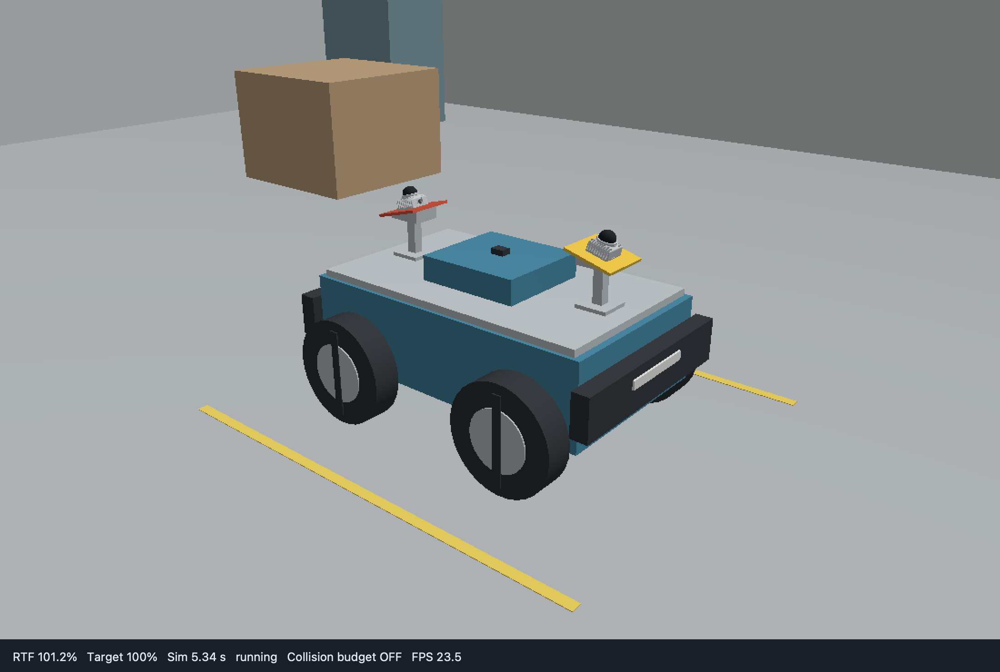

# 双 MID-360 巡检小车

独立 description/bringup 示例：四轮差速底盘、前后各向外俯倾 15° 的 MID-360、IMU 和工作间场景。完整配置步骤见[双 MID-360 从零搭建](../../docs/tutorials/双MID360从零搭建.md)。



## 启动

完成[安装与构建](../../docs/usage/安装与构建.md)后，在已加载安装环境的 Bash 终端执行：

```bash
export ROS_DOMAIN_ID=71 ROS_LOCALHOST_ONLY=1
ros2 launch dual_mid360_bringup bringup.launch.py
```

默认加载 `dual_mid360_bringup/config/ros.yaml` 中的出生位姿参数 `initial_pose_override`，并打开三维工作间和 RViz。`world:=minimal.sdf` 切换到最小场景，`gui:=false rviz:=false` 关闭窗口，`lidar_interface:=native` 改用原生 PointCloud2。自定义出生位置时复制 [ros.yaml](dual_mid360_bringup/config/ros.yaml)，修改其中的 `initial_pose_override`，再用 `params:=绝对路径` 加载；格式见[完整教程](../../docs/tutorials/双MID360从零搭建.md#3-配置场景和出生位姿)。Ctrl+C 结束整套 launch。

另一终端加载相同环境和 domain，发送车体速度：

```bash
ros2 topic pub -r 10 /cmd_vel geometry_msgs/msg/Twist '{linear: {x: 0.15}, angular: {z: 0.0}}'
```

点云默认位于 `/livox/front_mid360/lidar`、`/livox/rear_mid360/lidar`，类型为 CustomMsg；附属 `/pointcloud` 话题供 RViz 显示。IMU 为 `/imu/data_raw`，里程计为 `/odom`。

## 修改配置

| 包 | 内容 |
| --- | --- |
| [dual_mid360_description](dual_mid360_description) | 机械模型、车轮 collision、雷达安装结构与外参；drive.yaml 仅绑定轮组 |
| [dual_mid360_bringup](dual_mid360_bringup) | SDF 世界、仿真组合模型、传感器和控制器参数、ROS 参数、RViz 与 launch |

轮半径和轮距由完整 URDF 自动读取。雷达位置和倾角在 `rover.urdf.xacro` 中修改，传感器配置只绑定 link、话题及扫描参数。CAD 来源见[模型来源](dual_mid360_description/meshes/MID360_SOURCE.md)。

案例独立创建 RSP、controller_manager 和控制器，再调用公共仿真 launch。diff_drive_controller 发布 `/odom` 与 odom TF；joint_state_broadcaster 发布关节状态。源码 runtime 的 `robot.urdf` 留空，由 launch 传入组合模型路径。

控制管理器等待仿真就绪且时钟推进。`controller_startup_timeout` 默认 60 墙钟秒；暂停启动时须在超时前恢复或单步。第三方轮速/位置控制、话题 remap 和配置文件说明见[完整教程](../../docs/tutorials/双MID360从零搭建.md)。
